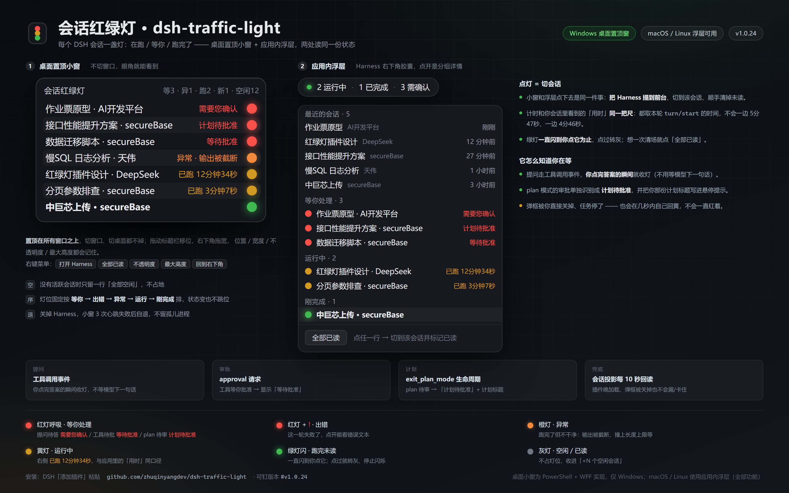

# dsh-traffic-light · 会话红绿灯

给 DSH 的每个会话点一盏灯，既能贴在 Harness 界面右下角，也能以一个**桌面置顶小窗**的形式一直浮在所有窗口之上，用来随时看"哪个会话在跑、哪个在等我、哪个刚跑完"。

## 形态

| 位置 | 说明 |
| --- | --- |
| 应用内浮层（`shell.overlay`） | 右下角胶囊，点击展开分组列表；可拖动；点击某一行切换到该会话 |
| 桌面置顶小窗（PowerShell WPF） | 无边框深色卡片，`Topmost`，在所有窗口之上；显示同一份灯态；点击某一行让 Harness 切到该会话 |

两者读同一个 host 端点 `GET /api/traffic-light/state`，所以状态永远一致。

## 灯语义

| 灯 | 含义 |
| --- | --- |
| 🔴 呼吸 | 正在等你：审批请求 / 提问未决 |
| 🔴 常亮 + `!` | 这一轮出错（可看 error 文本） |
| 🟡 常亮 | 正在跑（右侧显示 `用时 2分30秒`，计时口径与应用的"用时"一致：本轮开始到现在） |
| 🟠 常亮 | 异常：这一轮结束了但不干净（如输出被截断、撞上输出上限），右侧写明 `异常 · 输出被截断` |
| 🟢 一直闪烁 | 跑完了、你还没看（未读就一直闪，点灯后转灰、停止闪烁） |
| ⚪ | 空闲 / 中断 / 已读 |

每行右侧是一盏 14px 圆形信号灯：颜色即状态，左边文字只给有信息量的内容（`用时 2分30秒` / `需要您确认` / `等待批准` / `计划待批准` / `已等 45秒` / `出错` / `异常 · 输出被截断`），时长格式与应用会话里的计时完全一致（`N秒` / `N分N秒` / `N小时N分`）。**等待人工介入时灯变红并闪烁**，并按阻塞类型直接写明：待回答的问题是 `需要您确认`，待批准的操作为 `等待批准`，plan 模式下等待你审批执行计划是 `计划待批准`（悬停可看计划标题），其余等待显示已等时长。「正在等回答」这个判断有三条来源：`user-questions/request` 事件、`ask_user_question` 工具调用事件，以及宿主 `userQuestions` 会话投影（每 10 秒兜底读一遍，所以插件晚加载、或请求已经派发出去的情况下也能亮红）。`计划待批准` 单独靠 `exit_plan_mode` 工具调用的生命周期判定——它的审批走 `userQuestions.ask()` 的 `plan-review` 意图，既不触发审批事件也不进投影。**异常用橙色**（不是红色：任务没失败，只是结果可能不完整），点开看过就转灰。标签由宿主给全文、按卡片可用宽度省略（`…`），所以窗口拉宽后标题自然显示更多，不会提前截断；标题过长时也可拖动行内那条 6px 隐形分隔条（鼠标移上去变成左右箭头）**调整标题显示宽度**，双击恢复自适应，宽度记在 `%LOCALAPPDATA%\dsh-traffic-light\companion.json` 的 `labelWidth`；鼠标悬停 250ms 即弹出完整标题；行结构不变时只就地刷新文字，不会每秒重建控件（否则 ToolTip 会被反复销毁而弹不出来）。

小窗标题栏右侧常驻汇总：`待N · 错N · 异N · 跑N · 新N · 空闲N`（只显示非 0 项），空闲会话数不再占用底部空间。

子代理不单独占灯位，只挂在父灯上显示 `ˣN`。

## 交互

- **应用内胶囊**：拖动可移动（位置记在 localStorage），点击展开/收起，`Esc` 收起；面板按「等你处理 → 出错 → 异常 → 运行中 → 刚完成」分组，标题栏右侧显示 `跑N · 异N · 空闲N · 另有N条`；点行 → 打开该会话并标记已读；「全部已读」清空绿点。收起态胶囊里，`运行中 / 已完成 / 需确认` 三个数字**恒定显示**，只有数量大于 0 时才在数字前多一颗灯（`已完成` 闪绿、`需确认` 闪红）；这些灯与最左边那颗**同尺寸**，闪烁靠光晕与轻微缩放，不靠变淡，所以颜色始终饱和、不会看成灰色；`出错`/`异常` 有值时才追加；最左边的灯表示整体状态。
- **桌面小窗**：拖标题栏移动，**高度随行数自适应**（不再能拖高），只有**宽度可拖**（右下角左右箭头；宽度、位置、不透明度、最大高度一起记在 `%LOCALAPPDATA%\dsh-traffic-light\companion.json`，下次启动原样恢复）；右键菜单「最大高度」可选 自适应 / 200 / 300 / 400 / 520 / 640 px，超过就变成上下滚动，滑到底不会把卡片撑长（列表右侧是一条**自绘的 2px 细滚动条**，只有滑块没有轨道，鼠标移上去变亮、按住可直接拖动）；「不透明度」只调卡片背景，文字与灯始终保持实色，可选 100%–50%，另有「宽度恢复默认」「标题宽度自适应」（标题列回到按容器等分）、「回到右下角」复位吸附；点行 → 把 Harness 窗口提到前台（最小化会还原）并切到该会话，卡片边框闪一下表示"已切换"（若另一个会话里还留着未发送的输入，应用约 3 秒后会把主视图切回那个会话，属应用自身护草稿行为，插件只重试一次就让位）；菜单另有「打开 Harness」「全部已读」「退出」。Harness 关闭后小窗连续 3 次心跳失败会自行退出，不留孤儿进程。



## 平台支持

| 平台 | 应用内浮层 | 桌面置顶小窗 | 点灯切会话时前置应用 |
| --- | --- | --- | --- |
| **Windows** | ✅ | ✅（PowerShell + WPF，`Topmost`） | ✅ |
| **macOS / Linux** | ✅ 全部功能（胶囊、分组、最近的会话、点灯切会话、全部已读） | ❌ 不会启动，`/state` 里 `desktop.supported=false` 并写明原因 | ❌ |

宿主侧的状态聚合、四条 HTTP 端点、防误清逻辑都是纯 Node，跨平台；只有 `companion/*.ps1` 这两个脚本是 Windows 专有（PowerShell + .NET WPF）。所以在 macOS 上装出来是"应用内浮层完整可用、没有桌面置顶窗"。

如果你的使用场景就是"桌面上一直看到灯"，那 macOS 需要另写一个 companion（AppKit 的 `NSWindow.level = .floating` 或 Python tkinter 的 `-topmost`），小窗的抓取/渲染逻辑可以照搬现有的 JSON 协议。

## 安装

在 DSH 的「添加插件」对话框里粘贴仓库地址即可（会自动 `pnpm add git+https://…`）：

```
https://github.com/zhuqinyangdev/dsh-traffic-light
```

或用 plugin_manager 工具 / 本地目录：

```powershell
plugin_manager action=install_bundle target=E:\Data\DeepSeek\dsh-traffic-light
```

修改代码后需要 `remove_bundle` + `install_bundle` 才会重新加载（桌面小窗会在重新加载时自动重启）。

## 配置（可选）

通过 bundle patch 的 `config` 传给 `apply(ctx, config)`：

| 键 | 默认 | 说明 |
| --- | --- | --- |
| `maxLights` | `6` | 浮层/小窗最多显示几盏灯 |
| `recentCount` | `5` | 浮层「最近的会话」显示几条（`0` 表示不显示这一节；上限 50） |
| `titleTtlMs` | `60000` | 会话标题缓存时长 |
| `endpoint` | `/api/traffic-light/state` | 状态端点（同时派生 `/read`、`/focus`、`/focus/ack`） |
| `reconcileMs` | `10000` | 与 agent 注册表对账的周期 |
| `staleIdleMs` | `43200000` | 空闲且不在 live 注册表里的灯多久后从内存移除（默认 12 小时，历史会话才能留在「最近的会话」里） |
| `maxEntries` | `60` | 端点最多返回多少会话 |
| `sortOrder` | `asc` | 组内排序方向：按"用时"（运行中=用时、等你处理=已等、刚完成=本轮耗时）升序 `asc` 或降序 `desc` |
| `desktopWindow.enabled` | `true` | 是否自动拉起桌面小窗 |
| `desktopWindow.refreshMs` | `1000` | 小窗轮询间隔 |
| `desktopWindow.opacity` | `1` | 小窗卡片背景初始不透明度（只影响背景，文字始终实色；右键菜单改动会持久化并覆盖它） |
| `desktopWindow.width` | `300` | 小窗宽度（启动默认值；用户拖右下角改过宽度后以持久化的 `companion.json` 为准） |
| `desktopWindow.maxHeight` | `0` | 小窗最大高度（DIP）：`0` = 高度随行数自适应；`>0` = 到该高度后行列表上下滚动。之后以小窗右键菜单「最大高度」的选择为准（持久化到 `companion.json`） |
| `desktopWindow.focusApp` | `true` | 点灯时把 Harness 窗口提到前台（`companion/focus-window.ps1`） |

一个只想要应用内浮层、不要桌面小窗的例子：

```yaml
- insert:
    - id: traffic-light
      name: dsh-traffic-light
      config:
        desktopWindow:
          enabled: false
```

## 端点

| 方法 | 路径 | 用途 |
| --- | --- | --- |
| GET | `/api/traffic-light/state` | 全量灯态：`summary`、`sessions`、`focus`、`desktop`、`focusLog`（最近 8 次前置尝试） |
| POST | `/api/traffic-light/state/read` | `{sessionId}` 或 `{all:true}` 标记已读 |
| POST | `/api/traffic-light/state/focus` | `{sessionId}` 把"打开这个会话"排进队列（桌面小窗用） |
| POST | `/api/traffic-light/state/focus/ack` | `{ids:[...]}` 或空数组清空，消费 focus 队列 |
| POST | `/api/traffic-light/state/report` | `{kind,message,sessionId}` 客户端诊断上报（`GET state` 的 `reports` 里能看到最近 12 条） |
| GET | `/api/traffic-light/state/events?sessionId=…&limit=…&only=turns` | 只读诊断：最近 N 条会话事件（类型/序号/时间/工具名，不含工具参数），用来跟应用内计时对账 |
| GET | `/api/traffic-light/state/debug/question?sessionId=…` | 只读诊断：该会话 `userQuestions` 投影的当前内容、推出的等待原因，以及本插件灯上的 `waiting` |
| POST | `/api/traffic-light/state/debug/anomaly` | **测试用**：`{title?,workspace?,warning?,seconds?,waiting?,reason?,waitedMs?}`（默认 90 秒，上限 600）往状态里插一条假的「异常」行，用来查看橙灯外观；带 `waiting: 'plan' \| 'question' \| 'approval'` 时插的是红灯等待行（`reason` 为悬停说明，`waitedMs` 为已等时长），用来在没人提问时复现红灯；到期自动消失 |
| POST | `/api/traffic-light/state/debug/clear` | 清掉上面插入的所有假行 |

端口只监听 `127.0.0.1`（由 `webServer` 提供），无额外鉴权；如果以后要暴露到局域网，请先加 token。

## 文件

- `index.js` — host 聚合器：订阅 agent / session 事件，维护 `Map<sessionId, LightState>`，颜色归并、标题缓存、已读持久化、四条路由、拉起桌面小窗。
- `client.js` — 应用内浮层（`shell.overlay`，order 400）：胶囊 + 分组面板 + 拖拽 + focus 消费。
- `companion/traffic-light.ps1` — 桌面置顶小窗（WPF，`Topmost`，单实例 Mutex，心跳自退）。
- `companion/focus-window.ps1` — 点灯后把 Harness 主窗口提到前台（`AppActivate` → `BringWindowToTop`/`SetForegroundWindow`）。
- `cordis.patch.yml` — bundle patch（insert `traffic-light`）。
- `locale/{en,zh}.json`、`icon.svg` — 展示元数据。

## 发布（让同事在「添加插件」里直接装）

「添加插件」对话框接受三种输入：**npm 包名**、**GitHub 仓库地址**、**本地目录路径**。所以要走前两种，得先把包发到对应渠道。

### 路线 A：GitHub（最快，免费，不用改包名）

```powershell
cd <仓库目录>
git remote add origin https://github.com/<你的账号>/dsh-traffic-light.git
git push -u origin main
```

然后在 GitHub 仓库的 **About → Topics** 里加 `dsh-plugin`（插件商店靠这个 topic 发现它）。
同事在「添加插件」里粘贴 `https://github.com/<你的账号>/dsh-traffic-light` 即可安装，商店列表里也会出现。

### 路线 B：npm（包名要换，`dsh-traffic-light` 已被别人占用）

```powershell
npm login          # 或直接配 .npmrc 的 authToken
npm publish        # 需要 package.json 里没有 "private": true（本仓库已去掉）
```

同事在「添加插件」里粘贴包名（例如 `dsh-traffic-light-hud`）。

### 路线 C：商店内「一键发布」

插件商店 → 发布 → 填 Markdown 介绍 + 配 GitHub / npm token → 一键发布（自动建仓、打 `dsh-plugin` topic、推 release、npm publish），发布前会过安全扫描与 8 项质量门禁。

### 质量门禁自查（发布前）

- `package.json`：`name` / `version` / `description` / `license` / `keywords`（含 `dsh-plugin`）/ `exports` 齐全，**不能有 `private: true`**
- 仓库根有 `README.md`、`LICENSE`
- `files` 覆盖所有运行时文件（本仓库：`index.js`、`client.js`、`companion/*.ps1`、`cordis.patch.yml`、`locale/*.json`、`icon.svg`）
- 版本号与 README 更新日志、profile 里的安装来源一致（商店的 version-guard 会核对）

## 更新日志

### 1.0.29

- 胶囊最左边那颗灯只在**真有事**的时候才闪：有会话在跑（黄）或在等你回答（红呼吸）。以前只要还有未读完成，它也会跟着闪绿，可"刚完成"已经在胶囊里单独占一段、自带一颗闪绿的小灯了 —— 两颗一起闪是重复，现在左边那颗静态常亮。
### 1.0.28

- 修 1.0.27 的回归：分段灯（`已完成` 的绿灯、`需确认` 的红灯等）渲染成了**灰色**。原因是颜色表查两次 —— `capsuleParts` 已经取出十六进制值，`Dot` 又拿它当 key 去 `COLORS[...]` 里查，查不到就回落到灰。现在 `Dot` 统一走 `paint(color)`，**既接受 `"green"` 这类状态名，也接受 `"#3FB950"` 这类已解析值**，查不到才用灰。
- 桌面小窗不受影响（它自己的调色板独立）。
### 1.0.27

- 胶囊里 `已完成` / `需确认` 前面那颗灯改成**和左边整体状态灯同尺寸**（8px → 12px），不再显得小一号。
- 闪烁方式改了：以前是把透明度压到 0.25，深色胶囊背景下 8px 的绿点会糊成一块灰色；现在颜色**始终饱和**，靠光晕扩散 + 轻微缩放（0.82 ↔ 1.0，320ms 缓动）表现呼吸，既看得出在闪，也不会看成灰灯。
- 桌面小窗那盏灯没动（14px，样式你没提问题）。
### 1.0.26

- 胶囊口径修正：`运行中 / 已完成 / 需确认` 三个数字始终显示（哪怕是 `0`），**只有**数量大于 0 时数字前才多一颗灯 —— `已完成` 前闪动绿灯，`需确认` 前闪动红灯。1.0.25 曾把数量为 0 的整段隐藏，导致只剩一个数字。
- `出错` / `异常` 仍按"有值才出现"处理，各自带红/橙灯。
- 灯是呼吸式闪烁（700ms 一个来回，和桌面小窗同一节奏），不占用额外宽度。
### 1.0.25

- 收起态胶囊改成"每段带灯"：`已完成` 前面是**闪动的绿灯**，`需确认` 前面是**闪动的红灯**，`出错`/`异常` 也各带一个灯。灯只在对应数量大于 0 时出现。
- 计数为 0 的段直接不显示（不再出现 `0 需确认` 这种空段），全部为 0 时显示 `全部空闲`。
- 胶囊最左边的灯仍然表示"整体状态"（有需确认→红、有出错→红、有异常→橙、有运行→黄、只有未读完成→绿）。


### 1.0.24

- 明确平台边界：桌面小窗与"前置应用"依赖 PowerShell + WPF，**仅 Windows**。macOS/Linux 宿主不再反复尝试启动小窗，改为在 `/state` 的 `desktop` 里直接回报 `{ supported: false, platform: "darwin", error: "desktop window is Windows-only …" }`；应用内浮层在三个平台都完整可用。
- 新增 `desktop.platform` / `desktop.supported` 两个字段，客户端和外部监控脚本可以据此决定要不要提示"无桌面窗"。
- README 增加「平台支持」对照表。


### 1.0.23

- 「最近的会话」条数改为可配置：新增配置项 `recentCount`，默认 **5**（原来是写死的 10）。设为 `0` 就完全不显示这一节。
- 两个计数都做了收敛：`recentCount` 夹在 0–50、`maxLights` 夹在 1–50，写成字符串（`"8"`）也能用，配错不会把面板变成无限长列表。
- 改法：在插件配置里加一行即可，例如
  ```yaml
  - id: traffic-light
    name: dsh-traffic-light
    config:
      recentCount: 8
  ```


### 1.0.22

- 修「回答完提问后红灯要过很久才转黄」：`tool/result` 的 callId 在 `data.message.toolCallId` 里，**不在** `data.callId`（那里恒为 `null`），所以以前那句"结果返回就收灯"从来没匹配上，红灯只能等模型吐出下一条 `assistant/message` 才灭。现在按 `message.toolCallId` 精确匹配，你点完答案、工具返回的那一刻就收灯。
- 同时监听 `user/message` 里 `source.kind === 'user-question-reply'` 的"答案已采纳"事件，作为收灯的第二条快路。
- 定时版 `ask_user_question` 超时返回的 `{pending: true}` 结果**不会**被误当作已回答（红灯保持）。
- 收灯时把状态从 `waiting` 同步回 `running`/`idle`，避免出现"红灯灭了但变灰"的中间态。
- 实测：`ask_user_question` 的 `tool/result`（`resolved=call_00_fyArRjQZrMUfOCtXaMcw1123`, `pending:false`）落在 `09:46:41.691`，同一瞬间收灯；桌面小窗 1s 轮询，可见回落 ≈ ≤1s。
- 版本号 1.0.22。

### 1.0.21

- 修掉「把卡片拖到屏幕顶部后下不来了」：拖到屏幕边缘时 Windows 的 Aero Snap 会把这个无边框窗口**最大化**，而最大化的窗口对 `DragMove()` 完全没反应，于是卡片被卡在屏幕顶上、标题栏再也抓不住。现在三重保险：① `ResizeMode` 改为 `NoResize`（去掉 `WS_THICKFRAME`/`WS_MAXIMIZEBOX`，Aero Snap 不再能最大化它，缩放仍走自绘的右下角把手）；② 万一被系统改成非 `Normal` 状态，`StateChanged` 里立刻恢复窗口大小并放回原位；③ 拖动结束后把位置夹进工作区（顶边不能越过屏幕顶，底边至少留 24px 标题栏高度）。
- 启动时如果保存的位置在屏幕外，会把位置夹回可见区域**并回写**，不会每次启动都重复用一个越界坐标。
- 版本号 1.0.21。

### 1.0.20

- 新增「计划待批准」状态：`exit_plan_mode`（plan 模式下弹出执行计划、等用户审批）期间灯变红并显示 `计划待批准`，悬停可看到计划的标题。这个审批走的是 `userQuestions.ask({ intent: { kind: 'plan-review' } })`，既不发 `approval/request`、也不进 `userQuestions` 投影，唯一可靠信号就是那条一直挂起的 `exit_plan_mode` 工具调用——所以按工具调用的生命周期判定：调用发起即红灯，审批完成（同一 Turn 出现该步骤及之后的工具结果）或模型继续说话后自动回落。
- 「最近的会话」在宿主重启后不再只剩当场打开的两三个会话：除了当前 live 的会话，还会每 10 秒补扫 4 个历史会话（按创建时间从新到旧），把真实活动时间读回来填进列表；没读过历史的灯不参与排序（`recentAt: 0`），避免刚安装时用"发现时间"冒充最近活动。
- 空闲灯从内存移除的默认时间由 30 分钟放宽到 12 小时（`staleIdleMs`），这样历史会话能一直留在「最近的会话」里。

### 1.0.19

- 「最近的会话」改成真正的按最近活动时间倒序（越上面越近），不再把已经出现在状态分组里的会话过滤掉——所以当前正在聊的会话一定在第一行。重复出现是有意的：状态分组回答「谁在等我」，这一组回答「我最近在哪」。
- 每个会话多了一个 `recentAt` 字段（取最近活动、完成、开始、插件首次发现四者的最大值），面板直接按它排序；插件启动时用会话历史里最后一条事件的时间回填，所以刚安装、刚重启也能按真实先后排，不需要等新的活动事件。
- 启动扫描在"还没有任何 Agent 注册"时不再把自己标记成已完成，而是等下一次 10s 心跳重试，避免开机时机太早导致整张表没有标题和先后次序。

### 1.0.18

- 浮层面板顶部那一组的标题由「最近」改为「最近的会话」，写清它是按最近活动时间排的会话清单，而不是另一种状态分组。

### 1.0.17

- 「最近」分组里的行不再显示右侧的颜色圆点：这一组按「最近用过的会话」排序，不承担状态提示，去掉圆点后更像普通列表，也不容易和下方状态分组混淆。

### 1.0.16

- 浮层面板顶部新增「最近 · N」：按最近活动时间排序显示最多 10 个会话（含空闲/已完成），点一行同样会切到该会话。已经在下方状态分组里出现过的会话不会重复列在「最近」里，避免同一盏灯出现两次。

### 1.0.15

- 修掉「红灯刚亮就变回黄色」：宿主的 `userQuestions` 投影只跟踪**带 `timeout` 的 timed 版** `ask_user_question`，本 Harness 用的是阻塞版，所以它的视图永远是空。上一版把这个"空视图"当成权威结论，反而把工具事件推导出来的等待清掉了。现在投影**只能取消它自己建的等待**，事件推导的等待只由提问结果/新一轮/停止来结束。
- 等待期间红灯会一直保持（`turn/end`、`tool/result` 早到、状态被报成"已停止"这三种情况都不会再灭灯），答完后由接下来的工具调用或结果事件清掉。
- 诊断缓冲改为滚动窗口（最近 60 条），不再因为写满而丢掉最新事件。

### 1.0.12

- 「正在等回答」补上一路更可靠的来源：除 `user-questions/request` 与 `ask_user_question` 工具调用事件外，再读宿主 `userQuestions` 会话投影（实时 `onChanged` + 每 10 秒兜底轮询）。插件晚加载、请求已经派发出去、或事件被过滤的情况下，红灯也能按时亮起。
- 修掉一处误清：会话状态被报成"已停止"时不再清掉投影认定的等待（答题期间灯不会突然熄灭），且模型继续说话/调用别的工具也不会把投影等待冲掉。
- 新增只读诊断 `GET /api/traffic-light/state/debug/question?sessionId=…`，直接看某会话投影里的 `active/settled` 与灯上的 `waiting`。

### 1.0.9

- 应用内浮层：点面板以外任何地方（对话区、侧栏、标题栏）自动收起，Esc 同样生效——不用再点胶囊才关。
- 收起态胶囊文案改为 **运行中 / 已完成 / 需确认** 三个数字（出错、异常有值时额外追加），比原来的"运行 · 待处理 · 未读"更直白。
- 「已完成」= **未读的完成数**：点「全部已读」或点过某一行后清零，和绿灯一个口径。
### 1.0.8

- 滚动条改为**自绘 4px 滑块**：原生 `ScrollBar` 的宽度无法从模板里改（设成 4/2 实际仍渲染 5–7px），改为隐藏原生条、自己用 `Border` 画滑块，宽度、圆角、悬停色全部可控，位置随滚动同步、可按住拖动。
- 状态圆灯 12px → **14px**；卡片左右留白 10→8、上下 8→6；状态文字与圆灯之间留 6px 空隙。
- 关闭窗口时立即保存宽度/位置（不等防抖），避免"拖完马上关掉、下次没记住"。
- 渲染异常会写 `%LOCALAPPDATA%\dsh-traffic-light\companion-error.log`（平时为空）。

### 1.0.7

- 滚动条再细一档：4px 宽、圆角 2、滑块最小高度 22，行容器右侧空隙同步收到 7px。

### 1.0.6

- 修掉列表滚动条与行尾状态（meta 文案 / 圆灯）重叠：行容器右侧留 9px 内边距，6px 细条不再压住内容。

### 1.0.5

- 桌面小窗的列表滚动条从系统原生样式换成自绘的 **6px 圆角细条**：无灰色轨道、无上下箭头，鼠标悬停变亮、按住可拖动（`ScrollBar` 模板用 XAML 注入，见设计文档技术债 20）。

### 1.0.4

- 小窗高度改为**永远随内容自适应**，只能拖宽度（右下角把手改成左右箭头）。
- 新增「最大高度」菜单（自适应 / 200 / 300 / 400 / 520 / 640 px）：超过上限后行列表上下滚动，卡片不再被撑长；上限记在 `companion.json`，配置项 `desktopWindow.maxHeight` 只做启动默认值。
- 修掉一个会把列表越缩越小的反馈回路：滚动上限改为固定值，不再由窗口高度反推。

### 1.0.3

- 新增测试入口 `POST /api/traffic-light/state/debug/anomaly`（可带 `title/workspace/warning/seconds`）：往状态里插一条临时「异常」行，方便直接看橙灯长什么样，到期自动消失，`/debug/clear` 可立即清掉。

### 1.0.2

- 新增「异常」状态（橙灯）：一轮结束但结果不干净时（典型是撞上输出上限、回答被截断），小窗与浮层显示 `异常 · 输出被截断`，标题栏计 `异 N`，未读时参与未读计数，点开看过转灰。此前这种情况会被当成普通的"已完成"，看不出结果被截断。

### 1.0.1

- 计时改为与应用同源（取 `turn/start` 事件时间），重装后估算的起点会被真实事件时间纠正，界面用 `≈` 标注估算期。
- 组内排序按用时（`sortOrder` 可选 `asc`/`desc`），避免会话位置乱跳。

### 1.0.0

- 首个公开版本：host 聚合器（事件订阅 + 计时 + 已读持久化 + 5 条只读/操作端点）、应用内浮层（`shell.overlay`）、Windows 桌面置顶小窗（WPF，单实例、心跳自退、位置/尺寸/不透明度/标题宽度记忆）、点灯前置窗口 + 切会话、`ask_user_question` 等待红闪与自动清除。
